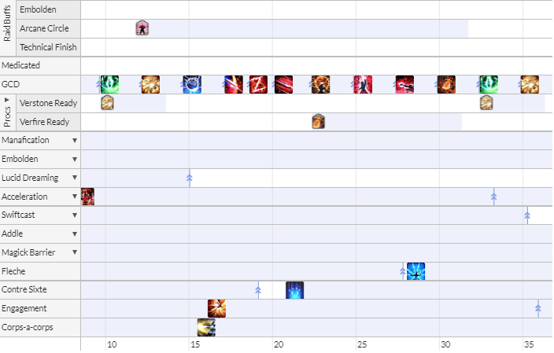
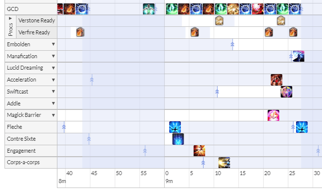
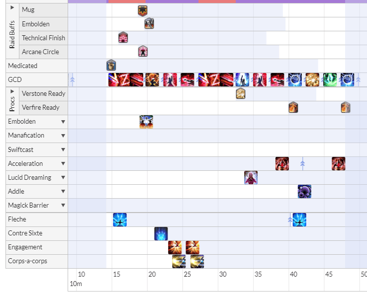

## **The Omega Protocol (Ultimate) RDM Guide**

This raid features a unique mix of multiple tight DPS checks, movement-intensive mechanics requiring real-time adjustment, and flexible optimization potential. That said, with some planning and smart resource management, Red Mage is able to perform well in this raid and bring a lot of value to a party.

There are six phases in this raid. Generally, every phase has a DPS check that requires some basic optimization, but the difficulty of DPS checks in phases 2 through 4 tend to depend on party composition and buff timings. The phases are commonly referred to by their number and will be referenced again as such later in the document. Refer to the below:

* Omega: P1
* Omega M/F: P2
* Omega Reconfigured: P3
* Blue Screen: P4
* Run: Dynamis: P5
* Alpha Omega: P6

### **Addle and Magick Barrier Usage**

Please be sure to read your server’s preferred mitigation sheet and [Meru's Addle and Magick Barrier Guide](https://bit.ly/3AHEMxZ) for tips and disclaimers on your various mitigation options.

### **Manafication Timings**

For anyone returning to this fight after Endwalker, due to the 7.0 Manafication change putting the free combo on a cooldown, fully rushing Manafication is no longer a viable option in this fight. It is technically possible to do with slow enough P1-P3 killtimes, resulting in being able to press Manafication and execute your melee GCDs before Delta in P5; however, this still requires Manafication to be delayed in Sigma until towers have resolved, and results in Manafication being desynced until the end of P6.

However, it is still very helpful to rush Manafication until P5 to gain an additional use in P2, as well as extra movement in P3 and P4; you can then re-align Manafication for post-Delta buffs and keep it aligned for the rest of the fight. This is still considered preferable to aligning Manafication, due to extra damage in P2 helping with party compositions that don’t put as much damage into the phase, as well as being able to hold the free combo in Hello, World in P3 in order to resolve more difficult tower timings.

When performing this partial rush, you will have about 30 seconds of leeway on drifting Manafication; however, it is still good practice to aim to use it as close to off-cooldown as possible.

### **Buff and Potion Timings**

In the modern era, buff usage has largely been standardized in this fight. Note that unlike many previous Ultimates, Phase 1 in this raid has a reasonably tight DPS check, so using a potion in the opener is generally a requirement. Some other potion uses are slightly flexible, but generally you will want to stick to a consistent plan around the following buff windows:

* P1: Opening \[Potion]
* P2: Opening
* P3: Opening \[Potion*], monitors 
* P4: None (melee LB3 used in this phase)
* P5: After Run: Delta \[Potion\*\*], and during Run: Omega \[Potion\*\*].
* P6: Opening, after second Cosmo Arrow \[Potion\*\*\*], and after Magic Number \[Potion\*\*\*]

\*If you only enter P3 with enough mana for a single melee combo, you can potion a double combo after the first set of towers instead as Manafication comes back up.

\*\*Your potion in P5 should be used wherever you end up using a triple combo, and will not have an effect on whether you can use a potion at the second buff window in P6

\*\**Your potion use in P6 will depend on how you are using your combos in the phase

Melee LB3 is held for P4, and a second use of raid buffs is used at the end of P3 instead during monitors. The downside of this is that bursting during monitors can be suboptimal due to mechanics generally requiring some players to drop GCDs; however, with current damage scaling and killtimes, having extra damage in P3 is fairly common. This can sometimes be preferred if using LB1 at the start of P2, due to LB generation being tighter in P3 in that scenario.

#### Holding DPS

During certain phases, the party may need to “hold DPS” to give more time for damage or defensive cooldowns to come back up. Due to how our Manafication lines up in this fight, Red Mage is one of the jobs that benefits substantially from the party holding DPS. Note that if you need to artificially slow down how fast you kill a boss, but you still need to build gauge, you can cast Veraero/Verthunder II. These spells do noticeably less damage in single target scenarios but generate the most mana out of our regular GCDs (Seven of white/black).

#### Gearing

We have multiple BiS options for this fight, between a fight-specific BiS set and an omni-BiS set that can be used for any legacy ultimate. 2.50 is the preferred GCD speed for this fight, as downtime means that alignment issues aren’t really a concern. Please refer to our [static BiS listing on XIVGear](https://xivgear.app/bisbrowser/rdm/ultimate) for the recommended gear options.

#### Procs at level 90

Ever since the release of Dawntrail, Jolt III at level 90 has been slightly stronger than our procs in terms of damage. Previous recommendations advised using procs regardless of this damage difference in order to set up a double combo approach to resolve Pantokrator. However, due to P2 DPS concerns in certain party compositions, we now advise resolving Pantokrator differently to allow use of an additional combo in the P2 reopener. Because of this, procs are no longer necessary to set up the combos in Pantokrator, and in fact are not necessary to reach any important mana thresholds throughout the fight. Therefore, it is recommended to use Jolt III throughout the fight.

# **Phase 1: Omega**

The DPS check in this phase is very tight compared to past Ultimates, and so a potion is often necessary. The two core mechanics of this phase, Looper and Pantokrater, are both movement-intensive. That said, there are reliable ways to handle them. 

In Dawntrail, 1st GCD openers have become increasingly standard in this fight. If we want to use a potion, it is extremely uncomfortable to do a 1st GCD opener without forcing a triple weave and clipping your GCD. However, since we aim to end the phase on a specific GCD in a melee combo, this clip typically won’t cause any lost GCDs. Therefore, you can use the following opener:


This opener sets up easier tether grabbing for the third in line scenario, as well as affording easier movement in the event of needing to resolve the first assigned mechanic at the north side of the arena. You can either clip Contre Sixte or drift it when it comes back off cooldown, but drifting it is likely the safer option.

#### Looper Movement

Movement during Looper can appear challenging, but smart positioning can noticeably reduce the movement required. Keeping track of where you will be moving next for the mechanic and prepositioning can help reduce situations where you have to move far significantly. Additionally, if you are one of the earlier tower numbers, you can stand inside later towers after losing your debuff, reducing movement needed to reach a safe spot from tethers.

Note that, in this phase, we want to build up enough mana to be able to perform a melee combo during Pantokrator, while also banking all of our uses of Acceleration and Swiftcast. As such, after the opener, we strongly recommend resolving the rest of Looper with only Dualcast and Sprint. The reason is because while relying on slidecasting can take a bit of practice for Looper, it is far more difficult to pull off during Pantokrator.

This can seem daunting at first, and you shouldn’t hesitate to drop casts during prog if you feel that you won’t make a movement in time, particularly for second in line players resolving their tether assignment. However, it is the kind of movement that is extremely doable with enough confidence, and being able to resolve it in this way makes you more flexible for later mechanics.

#### Pantokrator

Ideally, you want to be able to slidecast into your starting position for this mechanic. Assuming that you have kept your Dualcast alignment through Looper, you should have three Dualcast pairs between the final tower of Looper and the start of Pantokrator, starting a fourth pair just after the debuffs are applied. You should aim to identify your debuff and flex status during the hardcast of that pair, then slidecast into the instant cast to move out of the first puddle and into position for the stack, weaving Acceleration during this weave window. If you are not first in line, aim for the middle of the safe wedge to minimize the amount of adjustment needed to dodge the third flamethrower. If you are first in line, you can instead move into position under the boss.

Once you’ve moved into position after debuff assignment, perform one more Dualcast pair, spending both the Acceleration charge and the Dualcast proc, and then initiate a melee combo. You want to spend both Swiftcast and the remaining charge of Acceleration for two more instant casts after your combo is complete, and this should cover the entire rest of the mechanic while allowing you to carry the mana for a combo into P2.

This setup is mostly consistent in terms of execution, but runs into a bit of variation when resolving first in line. You could commit to the combo timing and attempt to bait your puddles at max melee range; however, the more responsible option is to shift the use of Swiftcast to be used before the melee combo, rather than after it. This allows you to bait puddles at a range on the way back to the party while still maintaining full uptime, positioning you to start the combo when you return to the party.

#### Ending the Phase

In this phase, we want to use Manafication on cooldown, or as close as possible to it. This means either delaying it to after a hardcast, or clipping it in if your group is killing quickly and you need to start your combo early. We are aiming for our last GCD of the phase to be Verholy/Verflare. This is because at the start of P2, we can cleave the bosses for two GCDs before Firewall comes up, so we want those GCDs to be Scorch and Resolution. You will also want to hold your last uses of your damaging oGCDs if possible, but don’t hesitate to spend them here if they are needed to beat the check. Prioritize holding Contre Sixte over Fleche, Corps-a-Corps, and Engagement

# **Phase 2: Omega M/F**

Unlike the previous phase, there is little to no movement optimization in P2. Instead, optimization here revolves around planning our cleave timings. Combining the combos we use in burst and the combo we gain from rushing Manafication, this should result in three and a “half” melee combos for the phase: a partial combo in the opener, plus an additional full combo, one after party synergy to cleave, and one with Manafication coming up around the Sagittarius arrow cast. If required, there is an additional one that can be used during the burn phase to meet the DPS check, but it’s better to save this combo for P3 if you can.

#### Cleaves: Standard P2 Opener and Post-Party Synergy

The standard play here is to open the phase by pre-casting Embolden when the circles that indicate the bosses spawning become visible, then cleaving both bosses with Scorch, Resolution, and Contre Sixte. Following that, perform a second combo as normal, then Dualcast as normal until Party Synergy. With the single combo resolution of Pantokrator in P1, you should be able to perform both of these combos and still have the mana for a cleaving combo after Party Synergy. The thresholds for doing this are 46|28 or 40|34, assuming you are only using Jolt III to set up Dualcasts.

After the knockback in Party Synergy, prepare a Dualcast, then do one instant-cast GCD and two dualcast pairs (five GCDs total, waiting for Omega-M to cast Synthetic Shield) before starting a melee combo to time your Scorch and Resolution to cleave both bosses. You should ensure that your Packet Filter debuff has dropped off before pressing Scorch; don’t be afraid to wait a moment if you think it’s necessary, as losing the Scorch cleave is much worse than losing a very small amount of GCD time.

Holding Contre Sixte to cleave after Party Synergy is optional. If you do, you will lose a use during P2’s burn phase, so either way you will only get three hits with it after Party Synergy.

After you press Resolution, Bow Omega M will appear around the perimeter of the arena, indicating that the position of the Sagittarius Arrow AoE is snapshotted. At this point, it should be safe to move into the middle of the arena. However, if you didn’t catch it or simply want to play safe, the indicator will appear in three more GCDs, so you can simply prepare Swiftcast for the dodge and to re-align your Dualcast. [Here is an example of this cleave and the following dodge.](https://youtu.be/RCW7wsJYuFs)

Once you’ve completed this dodge, it’s around this time that Manafication will come off cooldown. Use it and spend the combo as soon as possible, using Acceleration to re-align and avoid overcapping.

#### Ending the Phase

During the burn phase, you ideally want to build up as much mana as possible, at least 81|92 to allow a double combo reopener in P3. If your group is meeting the check comfortably and killing faster than expected, you may want to use AoE spells to speed up your mana generation while very slightly slowing down the killtime. Also, any damaging oGCDs available are free to be used here, as the P3 transition allows them to all be available for the reopener.

If damage is low due to unforeseen circumstances, you can spend an additional combo here and open P3 with a prepared Dualcast and a single combo. This is not the setup you should be aiming for in regular pulls, but it can help continue runs that otherwise might not make it out of P2.

**De-Synced Buffs Disclaimer**

Note that, on occasion, some jobs may opt to use 2-minute cooldowns here and **de-sync their buffs with the rest of the party, only to re-align it later**. This is common with Reapers, due to their raid buff being tied directly to gaining a free use of Enshroud. If you have a Reaper in your party, it can be helpful to be cognizant of their buff timing in P3, as it is reasonable for us to delay our free Manafication combo into that buff if we leverage the Manafication drift that we are afforded in the partial rush strategy.

# **Phase 3: Omega Reconfigured**

This phase is full uptime, and so optimization will mostly revolve around using your instant casts and melee combos properly. It is not a fast paced phase, but you may be required to move across a large area depending on tower RNG. The more resources you are able to carry over from P2, the lighter the DPS check for this phase will be.

#### Openers and Potion Window

If you are entering P3 with enough mana for a double combo, you can use a potion just before the boss is targetable (around the time the AoE puddle under the boss disappears after transition), and begin comboing immediately once Omega is targetable, using Embolden after the first Riposte. Preparing a Dualcast proc with Vercure is not recommended here with a double combo, as people tend to want to buff ASAP at the start of the phase.

If you are tasked with Addling the Hello World cast, it should be used immediately after your Verflare/Verholy cast at the latest. This is also the earliest weave window where you can weave Acceleration to get it on cooldown without the buff falling off. Similarly, weaving Swiftcast in this same weave window during the second combo will get it on cooldown as early as possible, assuming you spend both instants as soon as your combos end. If you are only opening with a single combo due to burning an extra combo in P2 to account for a mistake, Addle should be pressed after Redoublement instead.

#### Movement During Hello World

Your movement plan during Hello World should be designed to fit your own comfort. You have the option to dynamically adjust your unbuffed melee combo timings during this phase to handle more challenging movements (e.g. if your next tower spawns on the opposite end of the map), and use instant casts otherwise. However, it is entirely possible to devise a plan that will work in 100% of configurations. Outside of the opener, you will get one more combo with Manafication, another ready immediately after (this one can be held for a de-synced buff or used flexibly for movement), and one at the end of Hello World which is ideally saved for movement during monitors. 

One of the more important aspects of Hello World for RDM in particular is timing the debuff passes. It will almost always be better to move to grab or pass the debuff **before** planting for a Dualcast whenever possible, rather than starting the cast and forcing the other player to move more towards you, or picking it up late and risking a wipe. In these scenarios, it can be helpful to watch for the Defamation/Stack debuffs to fall off, as that is the indication of when the damage and position of those AoEs has snapshotted, and use those as the indicator of when it’s safe for you to move.

#### De-Synced Buffs

If a raid buff was de-synced at the end of P2, that raid buff should come up sometime between the second and third patch tether breaks. You have the option of either holding the Manafication combo for this buff and saving the combo from mana for later, or using the Manafication combo earlier and spending the mana combo in this buff, although the former option is generally preferred. You can also hold one charge each of Corps-a-corps and Engagement for the de-synced raid buff, which should roughly align with the movement toward your third set of towers.



#### Monitors and End of Phase

You should place a single melee combo into the buffs after Hello World; this can be accomplished without spending Swiftcast or Acceleration by waiting one Dualcast pair after raid buffs go out before starting a combo, in order to cover both movement and facing direction. Once in position, if you have a set of monitors, do not greed every GCD. If you otherwise kept good uptime throughout the phase, you should still end the phase with enough mana for the rest of the fight, and with Manafication coming off cooldown. Make sure you press Manafication on cooldown once again.

#### Red Mage and P4 damage

Unfortunately, due to the change in 7.4 that removed the damage buff from Manafication, Red Mage lost a bit of its damage in P4. On its own, this is not particularly concerning; however, there are a number of jobs that underperform in P4, and when those jobs are stacked together in the same party, this can cause damage issues in the phase. As such, in any given party, you should consider your composition and decide whether you may need to attempt to compensate for jobs that perform poorly in P4 (including ourselves), by shifting your Embolden from the end of P3 into the middle of P4.

As a general point of reference, jobs that rely heavily on burst damage tend to be weaker in P4, with the exception of Pictomancer, which still performs well due to being able to leverage downtime and dump large amounts of resources into the phase. Notable examples include Astrologian, Ninja, and Dancer, although these are not the only jobs that can struggle in this phase. By contrast, there are some jobs that perform very well in the phase, notably Monk, but also Black Mage and, as previously mentioned, Pictomancer.

If your composition is geared well towards dealing damage in P4, you will likely not need to worry about adjusting your Embolden timing. However, with other jobs that underperform in the phase, and even just without any jobs that overperform, it is worth considering holding Embolden. The timing of such an Embolden use will be outlined in the next section.

# **Phase 4: Blue Screen**

This phase has a moderately tight DPS check, but is mechanically quite simple and doesn’t require much optimization outside of moving efficiently. Your approach to this phase will largely depend on prior phase kill times, so you want to be flexible and able to adapt to an individual situation. However, you should always enter this phase with a prepared Dualcast to set up movement for the beginning of the phase, as we want our 7th GCD of the phase to be an instant cast, and this can either be naturally accomplished with this Dualcast alignment, or forced with a combo if your prior kill times were slow.

You will want to Dualcast through the beginning of the phase and aim for around 5 to 7 seconds left on your Magicked Swordplay buff before beginning your first combo. T**he absolute latest you want to press Riposte is with 5 seconds left on the buff**. If it is not time to combo after the first hit of Wave Cannon, you will want to leverage your instant casts to manage the following movement while setting up the aforementioned timing to start your first combo. Once you reach that point, initiate a double combo. **If you have held Embolden into this phase, use it after the first Redoublement**. This will more or less align it with any one-minute burst coming off cooldown, while still allowing you to use it with the party after Delta in P5.

If you use Swiftcast in this phase, it will be available for alignment purposes in the first uptime phase of P5 provided that you use it before the second stack here. A third melee combo will be available towards the end of the phase, but this should be held for P5 unless you need to make a desperation play to attempt to see P5 amid mistakes reducing damage in P4.

#### Final Fleche Use in P4

Depending on how fast or slow your previous phase killtimes were (and your oGCD alignment throughout P3), you may find a use of Fleche or Contre Sixte coming up at the very end of P4. With the approach to the first uptime phase in P5 that we will cover, it is technically possible, but unlikely, to be able to get two uses of Fleche without something ghosting, and the downtime before P5 is long enough that you will always get a use of Contre Sixte in the first uptime phase. Thus, it’s recommended to avoid actively holding Fleche or Contre Sixte at the end of P4 and simply use them as they become available.



# **Phase 5: Run: Dynamis**

While P5 is the consensus hardest phase in the fight, most of the difficulty comes from executing “trio” mechanics while the boss is untargetable, making the damage optimization aspect of this phase fairly straightforward. While P5 is often considered the hardest mechanically, it has the lightest DPS check of all phases. Nonetheless, optimizing our damage for this phase is still valuable, as it allows some jobs to build resources for P6, and can potentially allow this phase to be recoverable even after a death depending when it occurs, allowing for more P6 prog or even a clear on the same pull.

#### Vercure Usage

Red Mage lacks “free” self-mitigation when the boss is targetable, but given how the boss is not targetable in a lot of P5, Vercure becomes very useful for staying healthy. As a general rule of thumb, try to cast one whenever you are standing still, and save your second instant-cast one for times you can help heal yourself while moving. Times like this include (but are not limited to): while standing in position before Near/Distant World resolves in Run: Delta, after blue tether breaks in Run: Delta, before towers or before running around the arena in Run: Sigma, or while in position for monitor damage or Near/Far World in Run: Omega.

However, as we will discuss later, one of the preferred damage lines in this phase requires carrying the finishers of a melee combo through Delta. This means that when doing this line, you will not be able to use Vercure to heal yourself. Even if you make the decision to follow this line, you will likely want to keep the option for using Vercure in Delta while progressing to alleviate some strain from your healers.

#### Pre-Delta

You have enough time for 11 regular GCDs in this section. After a prepared Dualcast, you will want to do four Dualcast pairs (potentially replacing one pair with a Swiftcast +Acceleration combo), and then depending on the line you want to take after Delta, you can either perform another Dualcast or the first three hits of a melee combo. As mentioned before, the latter option sets you up for a high damage burst following Delta, but prevents you from using Vercure during Delta.

There is technically enough time in this phase to get two uses of Fleche, but it is tight to do so without ghosting, and only becomes tighter if you choose to perform a line that ends the phase with the first half of a melee combo. If you have Fleche off cooldown at the start of the phase, you can increase the likelihood of getting both uses by pressing it before your first GCD of the phase, and potentially delaying your last GCD by pressing it strictly off cooldown; since the damage application delay of Fleche is longer than that of our normal spells and Enchanted Redoublement, this line gives the most leeway to having all of your damage register here. If attempting this and not beginning your combo before Delta, consider saving Swiftcast + Acceleration to replace the last Dualcast pair.

#### Buff and Potion Timings 

Regardless of whether or not you drifted Embolden into P4, buff timings in this phase revert to following a simple, standardized pattern: the first use occurs after Run: Delta, and the second set of 2-minute raid buffs occur during Run: Omega. This is also the point where you want to revert to aligning Manafication with Embolden.

There are a few options for re-opening after Delta. If carrying finishers here, you can press Embolden as soon as Omega-M becomes visible, then resume your combo with a standard triple combo potion timing. If you aren’t carrying your finishers, you can either rush to the middle and initiate a melee combo without a prepared Dualcast (in which case you should use your potion just after the final Near/Distant jumps), or you can prepare a Dualcast and use that to return to the boss before initiating a combo (in which case you will need to use your potion after the first GCD). Whichever option you choose, you will get two full combos and four extra GCDs in this phase.



**Tips and notes:**

* It is safe to be in max melee range immediately after the Near/Distant World debuffs resolve, including if you are the last green/red tether and your partner is also max melee. However, depending on what role your partner is, you may wish to play safe with your distance.
* The boss is targetable here for under 35 seconds, so you can hold Contre Sixte, and two charges each of Corps-a-corps and Engagement for party member buffs.
* The last GCD has a high chance of ghosting, even with full uptime or if you started the phase with a Verthunder/aero III cast. Use it anyway for the mana.
* Since buffs tend to be sent early in this uptime in modern times, it should be trivial to get one use of Fleche under buffs and two uses under your potion.

#### Run: Omega (and Beyond)

This trio marks the first part of this phase where we have to do our rotation while also doing mechanics. That said, the movements aren’t too large, so complicated movement planning is unnecessary. Make sure that you’ve used three total melee combos across this phase leading up to Omega, in order to set up your mana for the buff window. If you're taking a line that only does two total melee combos before Sigma, you can delay your potion to here and perform a triple combo starting on the 6th GCD. Otherwise, aim for a standard double combo starting on the 11th GCD of the phase. In either case, press Embolden as it comes off cooldown, which will be after a Riposte if you followed the previously-suggested buff timing.

#### Optimizing oGCD use in Run: Omega

* You can only get two uses of Contre Sixte here, so put the second one under buffs.
* You can only get three uses of Corps-a-corps/Engagement here, so spend only one charge each at the start, and then you can save your second charge of each for raid buffs. The third charge for both abilities will come up during the buff window, but be careful not to use the second Corps-a-corps at the wrong time here and gap close into one of the clone kicks or slashes.
* It feels like three Fleche uses are possible here, with Fleche coming off cooldown at the very end of the phase. However, getting the third use requires pressing Fleche before your first GCD, and will cause your final GCD to ghost in the best-case scenario, resulting in only a 40 potency gain. It also keeps you from saving a use of Fleche for raid buffs, so if you have a buff-heavy composition with at least two other jobs providing raid buffs, it may not even be worth doing. Regardless of what you choose to do with Fleche here, if you are opting for a triple combo potion here, you should be able to get two uses of Fleche under the potion.

You should aim to exit this phase with as much pooled mana as possible. The more mana you exit with, the more flexible your combo usage will be in the first half of P6.

# **Phase 6: Alpha Omega**

For the final phase, the baseline is to execute nine melee combos across the phase. Due to the large movements required for some mechanics, it can be advisable to play safer with your usage of melee combos to handle movement, while saving instants (Swiftcast/Acceleration) for handling other movements.

This guide will cover a relatively safe combo plan for the phase. It should be understood that this plan is not optimized for damage, because with modern killtimes, optimizing this phase for damage involves doing the entire end of Unlimited Wave Cannon and the second Cosmo Arrow (“exalines”) mostly without a melee combo and few instant casts. This is dangerous because you need to be spreading away from another player at a very specific moment in the mechanic, which can be daunting to execute without a combo. While we previously recommended a daunting movement for Looper, performing such movements in the first minute of the fight is far less risky than at the 16-minute mark, due to the sheer difference in practice you will have and the added pressure of being on the final phase of the fight.

Movement, Combos and Potions 

Most commonly, your goal at the beginning of the phase is to begin by either spending a charge of Corps-a-Corps to start a 123e double combo, or spending Swiftcast and following it with a 1e23 double combo, with Embolden after Redoublement. The combo plan we are covering here is as follows:

1/2: Opener double combo
3: Exaflare 1 movement
4: Cosmo Arrow 2 movement, or continued Exaflare 1 movement
5/6: Wave Cannon 2 buffs into Exaflare 2 movement (Potion option 1)
7: Flexible use, but should be saved for the end of the phase if you are using a potion there
8/9: During buffs after Magic Number (Potion option 2, keeping in mind that you are likely to not get a full potion use)

If following the plan outlined in this guide, you will always be able to use a potion at either the second or third buff window. Using a potion at the first buff window isn’t recommended even if it’s available, as you need to rush to press your buffs and other oGCDs at this buff window. For the second window, this is either a fully-potted double combo if you spent the fourth combo for flexibility, or a standard triple combo potion with Embolden during the first combo if you are following the more dangerous lines. For the third window, this is during Magic Number where you can execute a triple melee potion (the first combo begins ~17/18 seconds before Embolden, and the potion would be used after the first Verholy/Verflare), or a fully-potted double combo if you spent the seventh combo for flexibility. 

With modern killtimes, you are unlikely to get a full ideal potion at the end of the phase, and so in reclears you can consider moving your potion to the second buff window. However, when pushing for a clear, it is strongly encouraged to just use potion for the final buff window, because the possibility that you lose personal damage to an early kill time is far less important than optimizing your damage for the purposes of simply getting the kill.

#### Cosmo Arrow 

Most of your instants in the first half of this phase will likely be used for Cosmo Arrow dodges. For the initial pulses of Cosmo Arrow it’s safe to cast during “two pulse” arrows, then rely on Acceleration/Swiftcast for “one pulse” arrows. Do not attempt to greed this mechanic, as it will easily end a pull.

[Out pattern with combo](https://youtu.be/CVEho7efY1I?t=924)[](https://youtu.be/hkH2AczmxuA?t=910)[](https://youtu.be/CVEho7efY1I?t=924)

[In pattern with casting](https://youtu.be/CVEho7efY1I?t=1002)

#### Unlimited Wave Cannon (Exaflares)

Both sets of Exaflares allow you to stay within max melee, allowing you to primarily rely on melee combos for movement. Before each set of Exaflares, you should cast as long as you can in the center of the arena until the initial AOE appears beneath you, at which point you can begin your combo.

As the first Unlimited Wave Cannon has proteans immediately after it, you can either use a second melee combo to move to your position or an instant if you have any remaining after Cosmo Arrow. Avoid using all of your movement tools as the second Cosmo arrow happens immediately after this mechanic.

#### Limit Break

Caster Limit Break 3 is required to resolve Cosmo Meteor. To do this, use LB3 as soon as you’re safe from the telegraphed AOEs, standing around the red line on the hitbox, allowing you to still be in proximity for healing as you’ll be animation locked for ~12.5 seconds. You need to place your LB3 at the center of the boss so that you can hit all of the meteors. It is strongly recommended that you use a macro to do this, as you will be running away from the boss to dodge the baited AOEs. Here is a working example:

```
/ac "Limit Break" <t>
/ac "Limit Break" <t>
/ac "Limit Break" <t>
/ac "Limit Break" <t>
/ac "Limit Break" <t>
/ac "Limit Break" <t>
/ac "Limit Break" <t>
/ac "Limit Break" <t>
/ac "Limit Break" <t>
/merror off
/micon "Limit Break" action
```

Avoid delaying your LB3 at all, even if your GCD is about to come off cooldown. Once it completes, you should be able to use a Dualcast and an instant cast resource to get into position, but if you aren’t using a potion at the end of the phase, this is a good place for your flexible 7th combo.

Good luck, and congratulations on your clear!

 

#### Fight PoVs:

Mazz Maryoku: [https://youtu.be/CVEho7efY1I ](https://youtu.be/CVEho7efY1I)

–

**Credits:** 

RDM team of Mentors and Helpfuls at The Balance <https://discord.gg/thebalanceffxiv> & <https://www.thebalanceffxiv.com/>